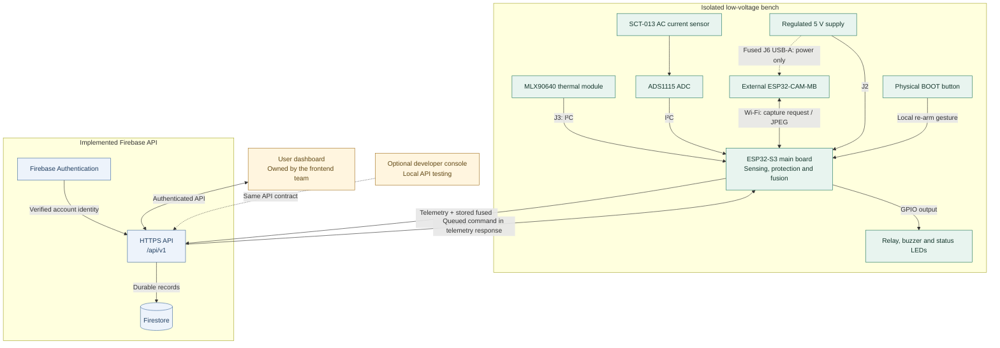
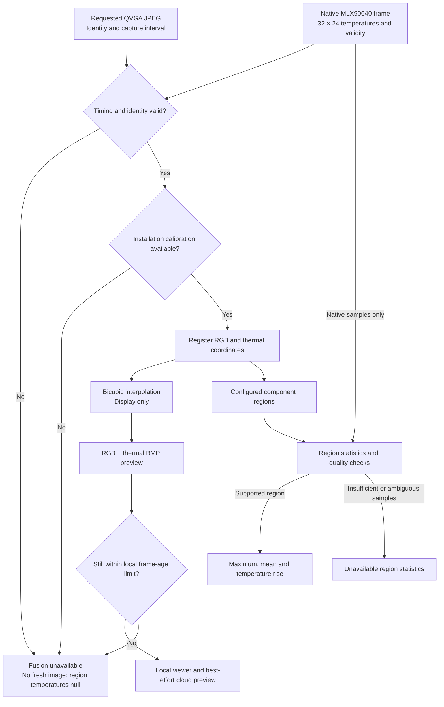
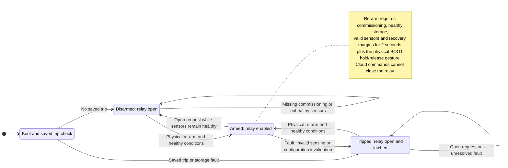
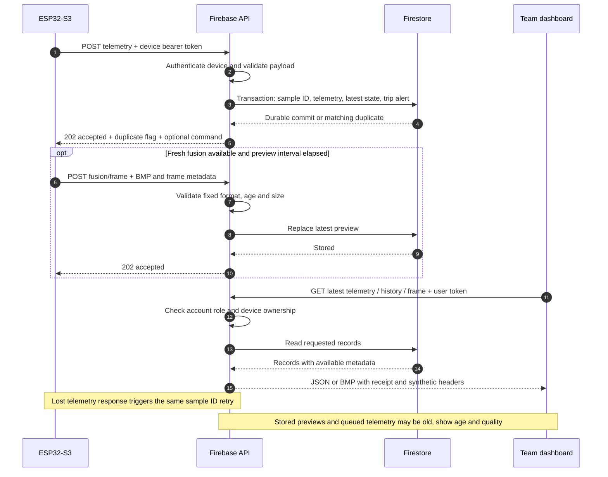
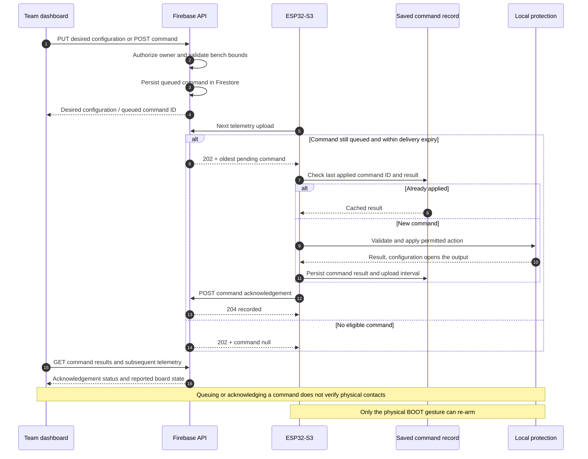

# Current v2 system architecture

Updated 10 October 2026. This page describes implemented bench behavior. The
[full architecture specification](../architecture_full_v1.1.md) also contains future
production requirements; those requirements are not a claim that every service exists.

## Responsibilities and data flow

Solid arrows show communication or a labeled electrical connection; dashed arrows
identify camera power and the optional test client. J6 carries no USB data.
Use a diagram's fullscreen button to inspect its labels.

| Component | Implemented responsibility | Source / contract |
|---|---|---|
| Permanent v2 PCB | 95 × 78 mm, four layers, S3 module, regulated 5 V logic supply, CT ADC, relay and two camera connections | [Hardware downloads](../hardware/index.md#files-and-previews) |
| ESP32-CAM firmware | Authenticated fresh 320 × 240 JPEG capture over local Wi-Fi; separate firmware image | [Firmware guide](../firmware/index.md) |
| ESP32-S3 firmware | Sensor acquisition, local threshold protection, physical re-arm, configuration/events, fusion, telemetry and command execution | [Code guide](../code/index.md) |
| Firebase HTTP API | Accounts/sessions, per-device keys, telemetry/history, in-app alerts, desired configuration, command acknowledgements and latest fused preview | [Team integration guide](index.md) |
| User dashboard | Product UI and user experience, implemented by the frontend team | [Postman/OpenAPI](../api/index.md) |
| Developer console | Optional local way to exercise the same API; not a product dependency | [Console scope](console.md) |
| Python CoAP gateway | Separate CBOR ingestion implementation for the wider architecture | [Gateway guide](../backend/index.md) |
| ByteLab | Related desktop firmware workspace; not a dashboard or device runtime | [ByteLab integration](../related/bytelab.md) |

## Hardware and firmware boundary

J2 is regulated 5 V logic input. J3 connects the MLX90640 using **1 SDA, 2 SCL, 3 GND,
4 3V3**. J4 USB-C programs the S3 through USB/UART. J6 powers the external ESP32-CAM-MB
through a USB-A to micro-USB cable; its data pins are unconnected. Program the camera
through its own USB base connected directly to the computer. J5 carries the separate
relay load path. The [pin map](../../smart_db_v2/pinmap.csv) is authoritative for firmware GPIOs.

The SCT-013 measures AC only. The selected firmware scope is isolated low-voltage AC
monitoring with a maximum 1 A trip setting. The hardware's earlier provisional 5–24 V DC
relay-contact test envelope does not establish an AC or mains contact rating. The logic
supply is DC. Hardware validation and manufacturer stackup review remain pending.

The saved PCB uses 0.30 mm preferred signal routes, 0.60 mm power, 0.75 mm 5 V/coil supply
and 1.00 mm load routes, with narrower local escapes. J6 has fused 5 V power and local
decoupling. The recorded ERC/DRC/parity checks are clean for the source hashes supplied
with the current downloadable project; this does not certify assembled electrical behavior.

## Local control and fusion

The high-priority local protection loop does not wait for Wi-Fi, Firebase or a dashboard.
It uses validated AC RMS current and native thermal temperatures, opens the relay on a
trip, and latches that condition. Only the deliberate physical BOOT gesture can re-arm.
Remote OPEN_RELAY and configuration commands can open the output, never close it.

The S3 pairs requested RGB captures with MLX frames, applies installation calibration,
and uses bicubic interpolation for display. Numerical region measurements are computed
from native 32 × 24 thermal samples. Interpolation adds no measured spatial resolution.
Real fusion remains unavailable until calibration is supplied; timing, ambiguous region
boundaries and missing samples can also make measurements unavailable.

### Fusion data flow

### Local protection state machine

Configuration application opens the output; it does not clear a saved trip. Storage faults
inhibit re-arm. The diagram describes firmware states, not measured relay-contact feedback.

## Cloud and frontend boundary

The S3 uploads JSON with a stable retry `sample_id`, null unavailable measurements, local
protection state, recent events and fusion metadata. Firestore persistence precedes the
202 response. Duplicate sample IDs with identical content are accepted idempotently;
conflicting content is rejected. Native tripped-state transitions create in-app alerts.

A 202 response may contain one queued command. The S3 validates/applies it and acknowledges
the result separately. The server stores desired configuration; the acknowledged command
and subsequent telemetry indicate application. Saving desired limits is not immediate
control. Applying limits preserves local CT scale/commissioning and requires physical re-arm.

The fused BMP uses a separate authenticated upload and overwrites the previous preview.
It is a stored snapshot, not live video. Team UIs must preserve synthetic labels, show
receipt age, and avoid treating device connectivity or interpolated pixels as evidence
of current sensor validity. The firmware's bounded telemetry queue can deliver older
samples after connectivity returns.

All application access goes through `/api/v1`; Firestore rules deny direct client access.
Device tokens are scoped to one device. Account roles and device ownership are checked
server-side. The frontend team can use a same-origin proxy or explicitly allowed CORS
origins. Local emulators use `demo-smartdb`; no live Firebase deployment has been performed.

### Telemetry and preview delivery

### Cloud command application

## Validation and remaining production work

PlatformIO builds validate the embedded images; portable tests cover fusion, protection,
settings and command retry behavior. Firebase emulator tests cover persistence, permissions,
sessions, commands and bounded previews. These are software checks, not hardware results.

The production specification's trained anomaly/vision models, learned risk fusion,
CoAP/DTLS integration, signed configuration, OTA updates, external notifications and
production operational controls remain separate work. The frontend team owns the user
dashboard implementation. Current device operation still needs physical calibration and
sensor/power/relay validation.
