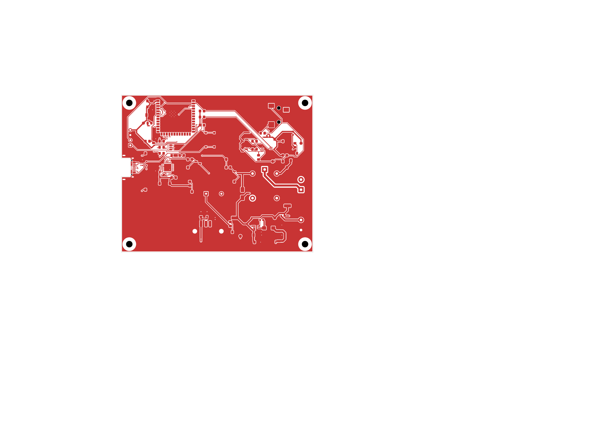
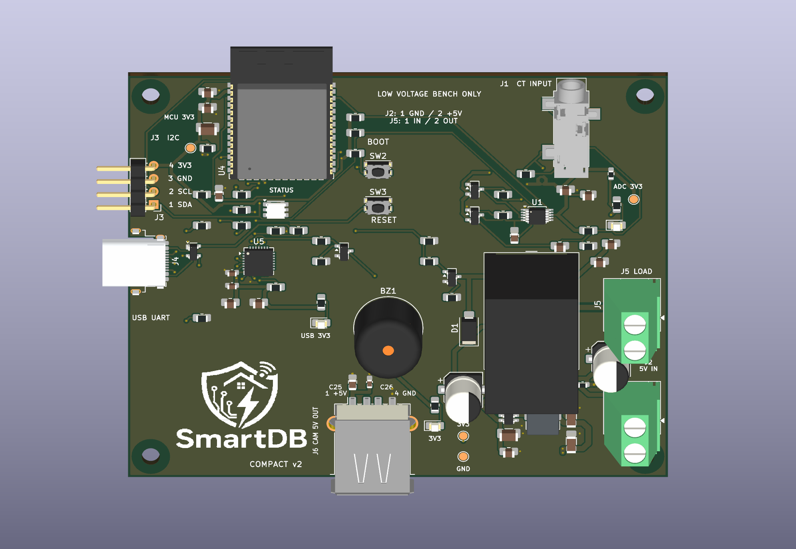

# SmartDB v2 — permanent compact project

The compact redesign is now the main v2 project in [`smart_db/`](smart_db/README.md).
Open [`smart_db/smart_db.kicad_pro`](smart_db/smart_db.kicad_pro) in KiCad 10.
The former `compact_wip/` folder has been moved here with its local libraries,
editing scripts, review outputs and saved history.

## Current revision

- 95 × 78 mm four-layer PCB with an ESP32-S3-WROOM-1-N16R8 module.
- Standard construction assumption: 1.6 mm FR-4, 1 oz outer / 0.5 oz inner copper.
- AP63203 buck supply, ADC supply filter, decoupling and test points.
- Accessible I²C and USB connectors, front/back pin labels and a SmartDB logo.
- Two camera connections: J3 for the MLX90640 thermal module, and J6 USB-A for
  ESP32-CAM-MB power through a USB-A to micro-USB cable. J6 uses SMD contacts,
  is fused and locally decoupled, and has no data connection. The
  [two-target firmware](../esp_idf/smartdb_fusion/README.md) provides Wi-Fi JPEG capture and
  S3 thermal fusion. See the [power budget](smart_db/work/camera_power_review.json).
- Fully routed board, including the buck converter, ADC, relay, USB/UART and control signals;
  [routing and trace-width review](smart_db/work/routing_review.md).
- Preferred widths: 0.30 mm signals, 0.60 mm power, 0.75 mm 5 V/coil supply,
  and 1.00 mm load paths, with narrower local escapes where required.
- Regulated 5 V logic input; provisional 5–24 V DC, up-to-1 A resistive relay test load.

**Routing complete: 0 unconnected items. Engineering review remains before fabrication.**
KiCad 10.0.6 reports 0 ERC violations, 0 DRC violations and 0 schematic/PCB mismatches.
See the [project notes](smart_db/README.md) for the remaining hardware and stackup validation.

## Firmware and setup

Open `esp_idf/smartdb_fusion` in VS Code and run **SmartDB: Setup**, or launch `./setup.sh`
from that directory. Set up the separate `esp32cam` board first, then the `smartdb_s3`
main board. The menu handles firmware installation, Wi-Fi, camera address, protection
limits and status. Connection settings persist on each board without subsequent reflashing.

Use J4 USB-C for main-board programming and connect the camera base directly to the computer
for camera programming. J6 is camera power only. The selected SCT-013 firmware monitors
**isolated low-voltage AC**; the logic supply remains DC, and the earlier provisional DC relay
load target is not a verified AC contact rating. Firmware builds/host tests pass; physical
sensor, relay, power and camera-alignment validation remain pending.

## Files and previews

[Download the complete current v2 CAD package](../docs/_build/artifacts/smartdb-v2.zip).
It includes the PCB, schematic, project-local libraries and 3D models, pin map, review
PDFs and validation record. Documentation builds verify every recorded source hash before
packaging; editor lock files, user preferences and historical work directories are excluded.
The bundle is generated by `docs/build.sh` or `docs/prepare_vercel.py`.

| File | Purpose |
|---|---|
| [Schematic](smart_db/smart_db.kicad_sch) | Editable schematic |
| [PCB](smart_db/smart_db.kicad_pcb) | Editable, fully routed compact board |
| [STEP assembly](smart_db/smart_db.step) | Current 3D preview; approximate connector models are not enclosure-fit references |
| [Copper PDF](smart_db/work/routing_current.pdf) | All four copper layers |
| [Schematic PDF](smart_db_schem_v2.pdf) | Current schematic export |
| [Placement PDF](smart_db/work/placement_current.pdf) / [PNG](smart_db/work/placement_current.png) | Front assembly and logo preview |
| [Bottom labels PDF](smart_db/work/back_labels_current.pdf) | Connector pin labels |
| [Pin map](pinmap.csv) | MCU signals and power connections |
| [Validation record](smart_db/work/validation_current.json) | Source hashes and checks |

Keep `SmartDB.kicad_sym`, `SmartDB.pretty/`, `sym-lib-table` and `fp-lib-table`
and `SmartDB.3dshapes/` beside the project. The library paths are project-relative.
The USB 3D model is an approximate visualization, not an enclosure-fit model.

## Previous revision

The previous routed bench board, its schematic PDF, STEP export, review reports,
project history and documentation are preserved in
[`archive/bench_before_compact_2026-10-08/`](archive/bench_before_compact_2026-10-08/README.md).
Its routing and validation results apply only to that archived board.

The current system requirements remain in the [architecture](../docs/architecture_full_v1.1.md).
